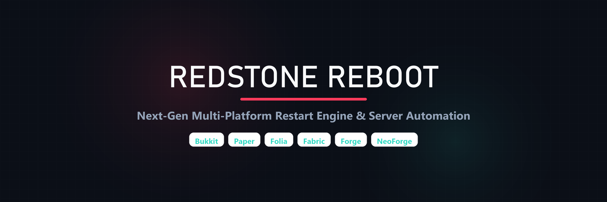

<div align="center">



# RedstoneReboot

**A restart engine for Minecraft servers across multiple platforms**

**Bukkit** · **Paper** · **Purpur** · **Folia** · **Fabric** · **Quilt** · **Forge** · **NeoForge**

</div>

---

## Overview

RedstoneReboot manages automated server restarts, health monitoring, and backend process handoff for Minecraft servers.

Works on single Paper instances, Folia networks, and Fabric, Quilt, Forge, or NeoForge servers running standalone or behind hosting panels.

### Features

| Feature | Description |
|---------|-------------|
| **Scheduling** | Set multiple restart times per day with timezone support and day-of-week filters |
| **Health Checks** | Tracks TPS and memory usage with consecutive checks to prevent false restarts |
| **Emergency Restarts** | Trigger immediate restarts if TPS drops or memory usage exceeds safety limits |
| **Notifications** | Countdown warnings via chat messages, titles, action bars, and note block chimes |
| **Backend Integration** | Coordinates with host panels, Docker policies, systemd units, and local scripts |
| **Hot Reload** | Update configuration live using `/reboot reload` without restarting the server |
| **PlaceholderAPI** | 8 placeholders for scoreboards, tab lists, and MOTD plugins (Bukkit and Folia) |
| **bStats Telemetry** | Anonymous usage statistics via [bStats](https://bstats.org/plugin/bukkit/RedstoneReboot/30751) |

---

## Quick Start

### Plugins (Bukkit / Paper / Purpur / Folia)

1. Download the JAR from [Releases](https://github.com/DemonZ-Development/RedstoneReboot/releases/latest).
2. Place it in your server's `plugins/` directory.
3. Start the server to generate default configuration files.
4. Configure `plugins/RedstoneReboot/config.yml` and `plugins/RedstoneReboot/restart-backends.properties`.
5. Run `/reboot reload` to apply settings live.

### Mods (Fabric / Quilt / Forge / NeoForge)

1. Download the matching mod JAR for your loader and Minecraft version.
2. Place it in your server's `mods/` directory.
3. Start the server to generate `config/redstonereboot/`.
4. Configure `config/redstonereboot/redstonereboot.properties` and `config/redstonereboot/restart-backends.properties`.
5. Run `/reboot reload` to apply settings live.

---

## Supported Platforms

| Platform | Type | Minecraft Versions | Java Runtime | Notes |
|----------|------|--------------------|--------------|-------|
| **Bukkit / Spigot / Paper / Purpur** | Plugin | `1.9` to `26.3+` | Java 17+ / Java 25 (26.x+) | Universal plugin jar |
| **Folia** | Plugin | `1.20+` to `26.3+` | Java 17+ / Java 25 (26.x+) | Dedicated region-threaded build |
| **Fabric** | Mod | `1.20.1`, `26.1`, `26.2`, `26.3+` | Java 17 (1.20.1) / Java 25 (26.x+) | Requires Fabric API |
| **Quilt** | Mod | `1.20.1`, `26.1`, `26.2`, `26.3+` | Java 17 (1.20.1) / Java 25 (26.x+) | Supported via Fabric mod build and Quilted Fabric API (QFAPI) |
| **Forge** | Mod | `1.20.4`, `26.1`, `26.2`, `26.3+` | Java 17 (1.20.4) / Java 25 (26.x+) | Dedicated server build |
| **NeoForge** | Mod | `1.21.1`, `26.1`, `26.2`, `26.3+` | Java 21 (1.21.1) / Java 25 (26.x+) | Dedicated server build |

All stable and modern Minecraft 26.x mod builds (26.1, 26.2, and 26.3) are bundled directly into official [GitHub Releases](https://github.com/DemonZ-Development/RedstoneReboot/releases/latest).

---

## Commands

| Command | Permission | Description |
|---------|------------|-------------|
| `/reboot` | `redstonereboot.use` | Show plugin status and help |
| `/reboot status` | `redstonereboot.status` | View restart schedule and countdown |
| `/reboot info` | `redstonereboot.info` | Show server health diagnostics |
| `/reboot now [delay]` | `redstonereboot.now` | Trigger a restart with optional countdown |
| `/reboot schedule <seconds>` | `redstonereboot.schedule` | Schedule a future restart |
| `/reboot cancel` | `redstonereboot.cancel` | Cancel a pending restart |
| `/reboot doctor` | `redstonereboot.doctor` | Run backend and environment diagnostics |
| `/reboot reload` | `redstonereboot.reload` | Hot-reload all configuration files live |

---

## PlaceholderAPI Integration

RedstoneReboot integrates with [PlaceholderAPI](https://www.spigotmc.org/resources/placeholderapi.6245/) on Bukkit and Folia servers.

| Placeholder | Output Example |
|-------------|----------------|
| `%redstonereboot_next_restart%` | `2026-04-15 06:00:00 Europe/London` |
| `%redstonereboot_time_until%` | `2h 30m` |
| `%redstonereboot_status%` | `Normal operation` or `Restart in progress` |
| `%redstonereboot_reason%` | `Scheduled Restart` or `None` |
| `%redstonereboot_tps%` | `19.8` |
| `%redstonereboot_memory%` | `62.4%` |
| `%redstonereboot_version%` | `1.6.5` |
| `%redstonereboot_timezone%` | `Europe/London` |

---

## Backend System

RedstoneReboot separates "when to restart" from "how to restart" through its backend engine. Configure `restart-backends.properties` to choose:

| Backend | Mode | Description |
|---------|------|-------------|
| `DEPEND_ON_HOST` | Default | Graceful shutdown. Relies on your hosting panel (Pterodactyl, Bloom, PebbleHost, Bisect, Docker, etc.) to reboot the server process. No custom flags required. |
| `LOCALSCRIPT` | Supervisor | Auto-generated wrapper script handles the restart loop for local testing or bare metal. |
| `SYSTEMD` | Supervisor | Integrates with Linux systemd service units. |
| `DOCKER` | Supervisor | Works with Docker container restart policies (`restart: always`). |
| `PTERODACTYL` | Direct API | Dispatches restart signals directly via Pterodactyl Client API keys. |

### What does ASSISTED mean in `/reboot doctor`?

If you configure a supervisor backend (`LOCALSCRIPT`, `SYSTEMD`, or `DOCKER`), RedstoneReboot checks for proof that an external watcher is running (`-Dredstonereboot.active=true` in startup flags or `REDSTONEREBOOT_ACTIVE=1` in the environment).

Without this flag, `/reboot doctor` reports the **ASSISTED** state to protect against stopping a server on a host with no restart loop.

If your host already reboots stopped servers automatically, you do not need supervisor wiring. Set `backends-enabled=false` or `active-backend=DEPEND_ON_HOST` in `restart-backends.properties`.

---

## Marketplaces & Downloads

- [**GitHub Releases**](https://github.com/DemonZ-Development/RedstoneReboot/releases/latest)
- [**Modrinth**](https://modrinth.com/plugin/redstonereboot)
- [**CurseForge (Mods)**](https://www.curseforge.com/minecraft/mc-mods/redstonereboot)
- [**CurseForge (Bukkit)**](https://www.curseforge.com/minecraft/bukkit-plugins/redstonereboot)
- [**Hangar**](https://hangar.papermc.io/DemonZ/RedstoneReboot)
- [**SpigotMC**](https://www.spigotmc.org/resources/redstonereboot.120387/)
- [**BukkitDev**](https://dev.bukkit.org/projects/redstonereboot)

---

## Documentation & Community

- [**Wiki**](https://github.com/DemonZ-Development/RedstoneReboot/wiki)
- [**Developer API**](https://github.com/DemonZ-Development/RedstoneReboot/blob/main/wiki/Developer-API.md)
- [**bStats Metrics**](https://bstats.org/plugin/bukkit/RedstoneReboot/30751)
- [**Discord Support**](https://discord.gg/GYsTt96ypf)
- [**Source Code**](https://github.com/DemonZ-Development/RedstoneReboot)
- [**Issue Tracker**](https://github.com/DemonZ-Development/RedstoneReboot/issues)

---

## Building from Source

```bash
git clone https://github.com/DemonZ-Development/RedstoneReboot.git
cd RedstoneReboot
./gradlew build
```

Requires **Java 21+** for building (NeoForge toolchain requirement).

---

## License

This project is licensed under the Apache 2.0 License. See [LICENSE](LICENSE) for details.

---

<div align="center">

Made by [**DemonZ Development**](https://demonz.org)

</div>
